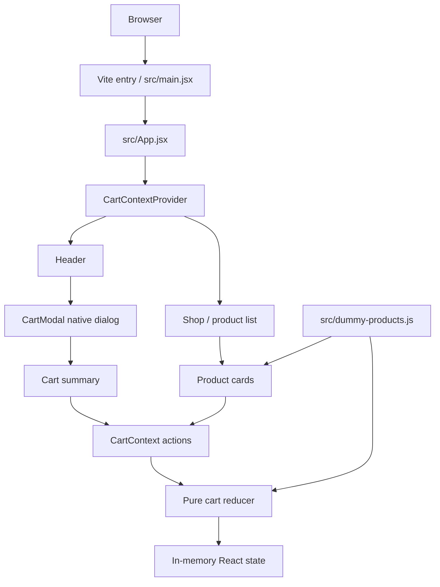

# Architecture

## 1. System overview

ShoppyCart is a browser-only React storefront demonstration bundled with Vite. The app renders a static clothing catalog and exposes cart interactions through React Context and a reducer. It has no backend application, database, account system, order service, inventory service or payment processor.

## 2. Boot sequence

1. Vite serves `index.html`.
2. `index.html` provides the root element and modal portal target.
3. `src/main.jsx` imports React, ReactDOM, the app and global CSS.
4. React mounts `App` under StrictMode.
5. `App` wraps the page in `CartContextProvider`.
6. `Header` renders the cart trigger and the portal-backed dialog.
7. `Shop` renders the supplied product cards generated from `DUMMY_PRODUCTS`.

## 3. Feature boundaries

### Catalog
`src/dummy-products.js` exports six local clothing fixtures. Images are imported from `src/assets/` and bundled by Vite. Prices are static numeric values expressed in dollars by the UI.

### Cart state
`src/store/shopping-cart-context.jsx` provides `items`, `addItemToCart`, and `updateItemQuantity`. It delegates transitions to the pure reducer created from the same catalog.

### Cart UI
`Header` displays the total unit quantity and opens `CartModal`. `CartModal` portals a native HTML dialog into `#modal`. `Cart` renders empty/non-empty states, line quantities and a calculated total.

## 4. Data and persistence

Product data is bundled into the frontend. Cart state is held in `useReducer` memory only. Reloading the page resets the cart. There is no localStorage, IndexedDB, remote API, user session, server-side price validation, inventory reservation or checkout.

## 5. Trust boundary

All product data and cart state are controlled by the browser. A visitor can inspect or modify the bundle and runtime memory. Therefore:
- displayed prices are illustrative;
- cart quantities are not trusted order data;
- cart totals are not payment amounts;
- the UI cannot reserve stock or create a real order;
- a checkout implementation must send product identifiers and quantities to a trusted server, where current price, availability, tax, shipping and totals are recalculated.

## 6. Production architecture direction

A real commerce implementation requires separately designed identity/session, catalog, inventory, cart/order, tax/shipping, payment provider, notification, audit, and customer-data services. The static demo should not be presented as a transaction-capable store until those services exist.
