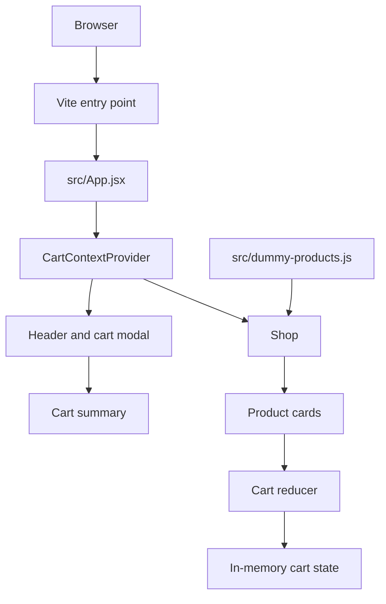

# Architecture

## State model
The provider exposes cart items, `addItemToCart`, and `updateItemQuantity`. The reducer supports adding a product and incrementing or decrementing its quantity. Cart state is not persisted between reloads.

## Data boundary
Product fixtures and displayed prices are static browser data. There is no API or backend in this repository.
